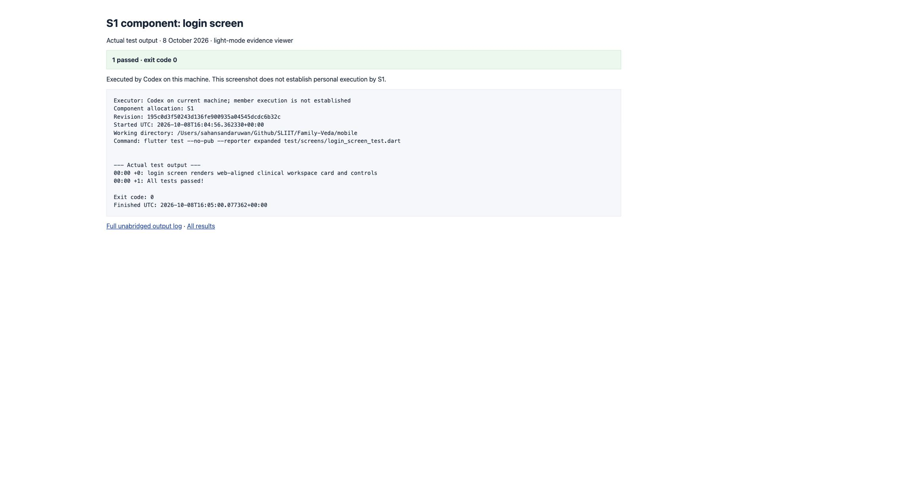
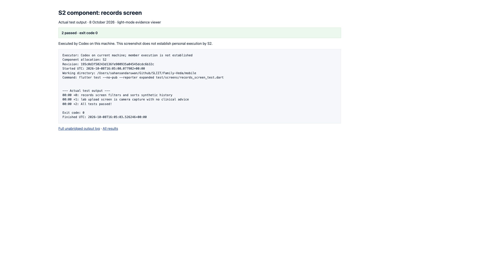
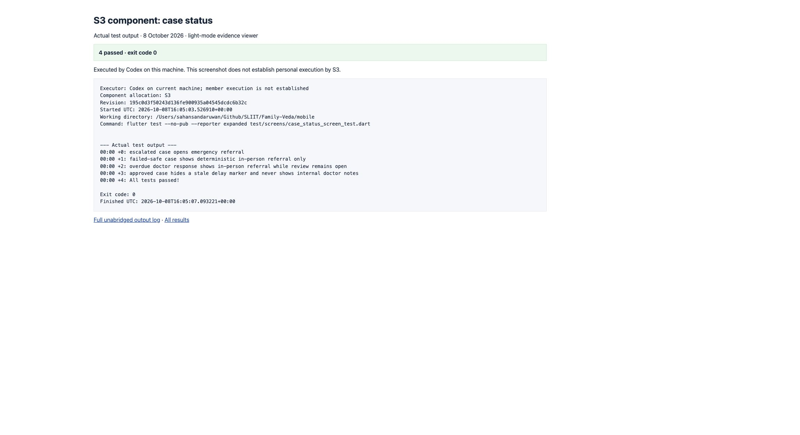
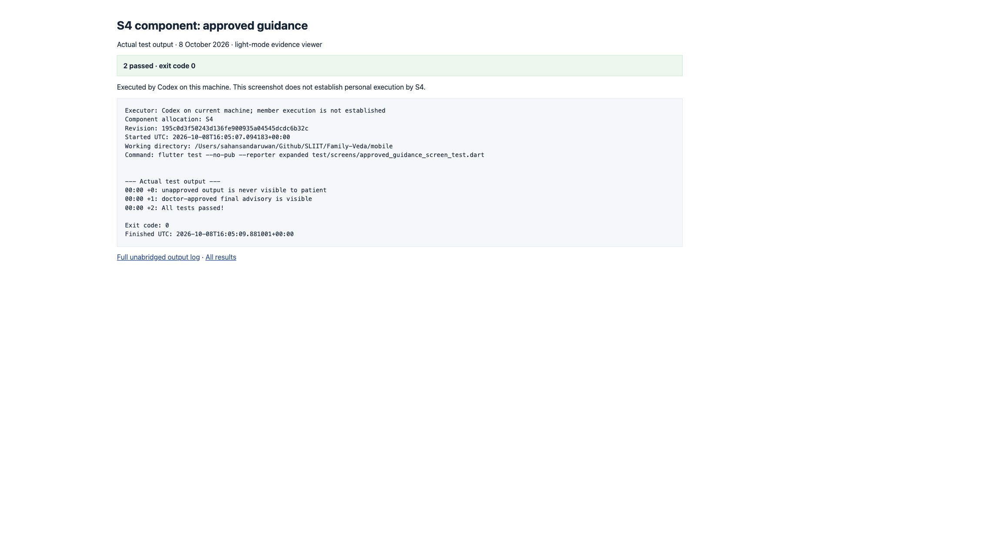
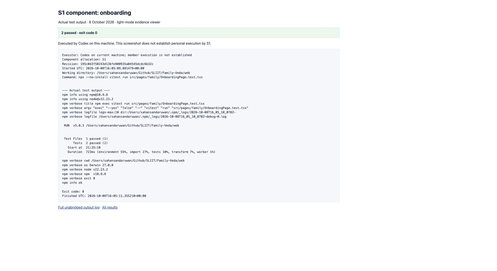
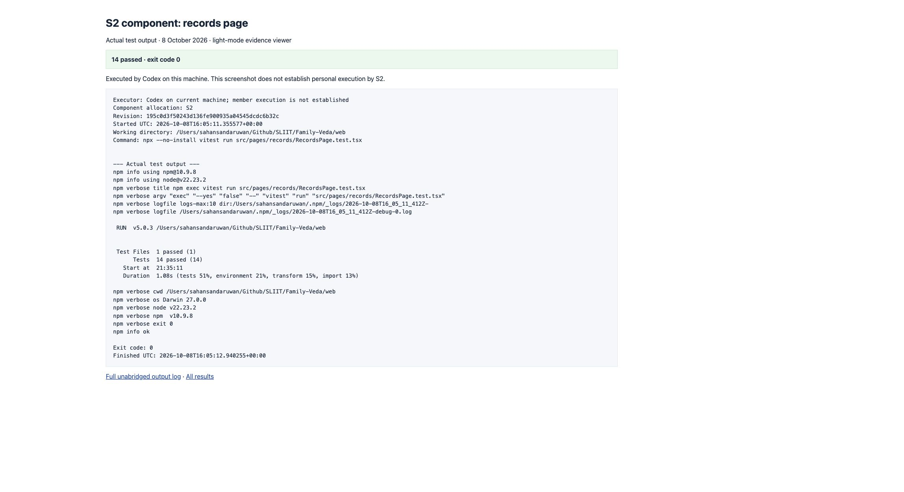
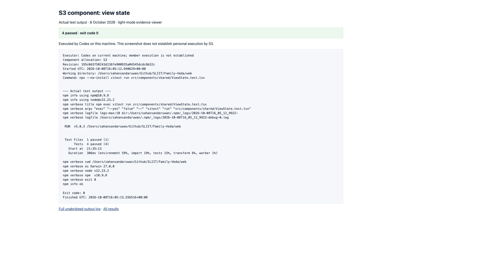
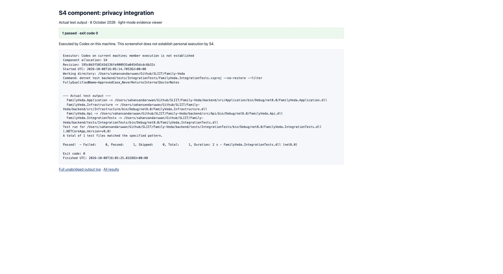

# Member component test-run evidence

Executed by Codex on the current machine on 8 October 2026. No member personal execution, supervision, independent review or viva readiness is established by these runs. Existing checkout and installed dependencies were used; no clone, pull or dependency installation was performed. Revision is retained in each log.

| Allocation | Test | Passed | Exit | Log |
|---|---|---:|---:|---|
| S1 | login_screen | 1 | 0 | [S1-login_screen.txt](S1-login_screen.txt) |
| S2 | records_screen | 2 | 0 | [S2-records_screen.txt](S2-records_screen.txt) |
| S3 | case_status | 4 | 0 | [S3-case_status.txt](S3-case_status.txt) |
| S4 | approved_guidance | 2 | 0 | [S4-approved_guidance.txt](S4-approved_guidance.txt) |
| S1 | onboarding | 2 | 0 | [S1-onboarding.txt](S1-onboarding.txt) |
| S2 | records_page | 14 | 0 | [S2-records_page.txt](S2-records_page.txt) |
| S3 | view_state | 4 | 0 | [S3-view_state.txt](S3-view_state.txt) |
| S4 | approvals_page | 8 | 0 | [S4-approvals_page.txt](S4-approvals_page.txt) |
| S4 | privacy_integration | 1 | 0 | [S4-privacy_integration.txt](S4-privacy_integration.txt) |

Screenshots display actual logs in a light-mode browser evidence viewer, not the native Terminal app. Full logs are retained beside each screenshot. Integration test used the existing Testcontainers configuration and disposable PostgreSQL.

## Report-ready factual execution paragraph

On 8 October 2026, Codex executed nine focused test commands on the current machine at revision 195c0d3: eight Flutter/React component commands and one PostgreSQL integration regression command. All 38 tests passed, with no failed command. S4 component checks passed 2 Flutter tests and 8 React tests; the internal-doctor-note privacy regression passed 1 integration test. Full command output and light-mode browser screenshots are retained in `docs/QMSE/evidence/2026-10-08-member-test-runs/`. This records AI-assisted execution, without attributing personal execution, supervision, independent PR review or viva competence to any student.

## S4 behaviours checked

- `approved_guidance_screen_test.dart`: `unapproved output is never visible to patient`; `doctor-approved final advisory is visible`.
- `GoldenCaseFlowTests.cs`: `ApprovedCase_NeverReturnsInternalDoctorNotes_AndClearsStaleDelayMarker` verifies the approved patient response omits internal doctor notes and clears the obsolete processing-delay marker.
- `ApprovalsPage.test.tsx`: eight passing React tests, full output retained.

## Screenshots

### S1 — login_screen

### S2 — records_screen

### S3 — case_status

### S4 — approved_guidance

### S1 — onboarding

### S2 — records_page

### S3 — view_state

### S4 — approvals_page

### S4 — privacy_integration

